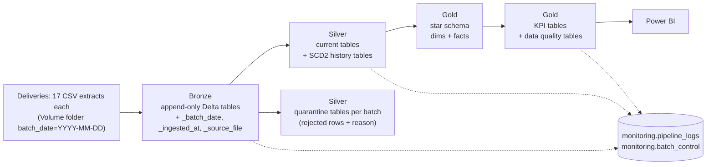
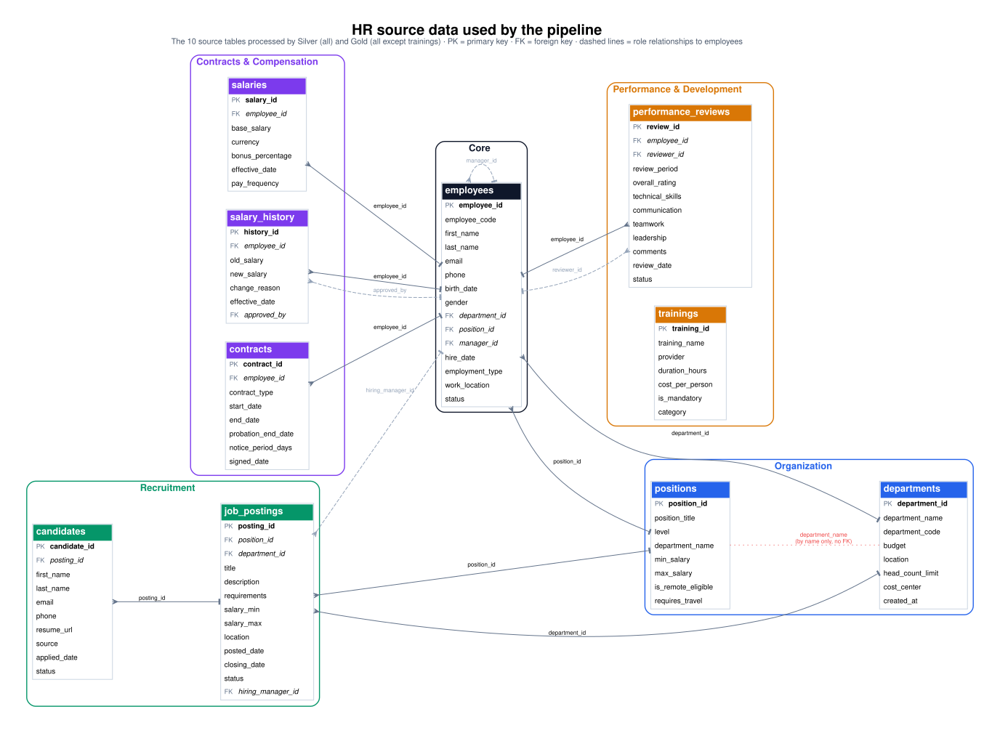
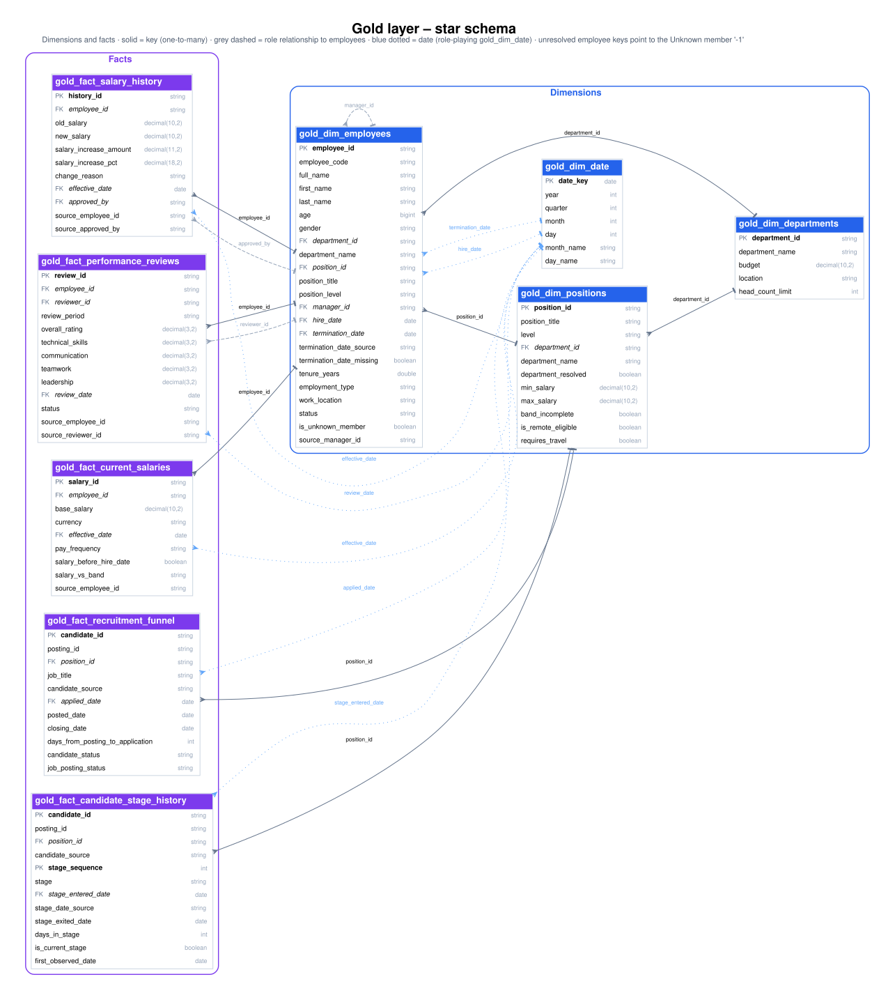
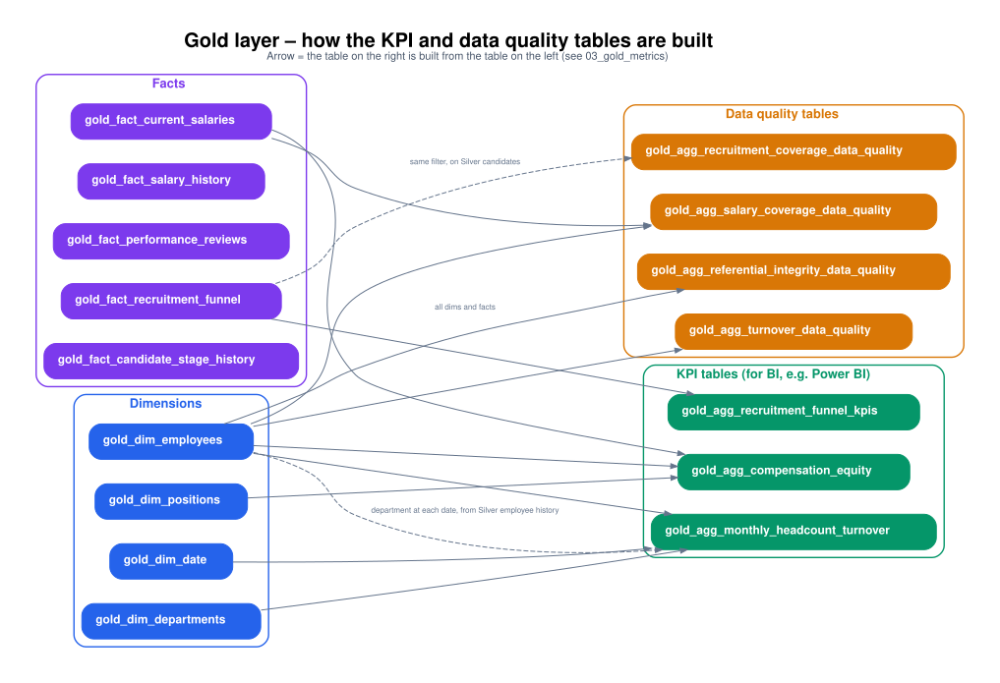

# HR People Analytics Pipeline (Databricks · PySpark · Medallion)

End-to-end data pipeline that turns raw HR system extracts into analytics-ready tables for three People Analytics use cases:

- **Turnover & retention** – monthly headcount, gross turnover and early turnover per department.
- **Recruitment funnel & channel performance** – source yield, time to fill, time to hire.
- **Pay equity & compa-ratio** – payroll, average salary and compa-ratio by department, position and gender.

Built on Databricks (Unity Catalog, Volumes, Delta Lake) with PySpark and Spark SQL. The source data is **synthetic** and intentionally messy (see [`data/README.md`](data/README.md)).

Since v3 the pipeline loads **incrementally**: each delivery of the source is appended to Bronze, and Silver keeps the history of employees, candidates, positions, contracts and job postings (**SCD Type 2**, with Delta `MERGE`). That history is used to recover termination dates, to count headcount in the department each employee had at each date, and to track candidates through the stages of the funnel. See [Incremental loading](#incremental-loading).

**Documentation:** this README gives the overview · [`docs/analysis.md`](docs/analysis.md) has the in-depth analysis of each metric and data quality finding · [`CHANGELOG.md`](CHANGELOG.md) documents every change with its evidence.

---

## Key findings

1. **Turnover cannot be measured reliably yet.** 43 of 50 terminated employees (86%) have no termination date, so monthly turnover reflects only 7 terminations. The gap is flagged and quantified per department instead of hidden; loading termination dates at the source is the top priority.
2. **One in five active employees has no usable salary.** 52 of 272 active or on-leave employees (19%) have no valid current salary and are excluded from payroll and compa-ratio, so those KPIs cover 81% of the workforce.
3. **The position catalog needs an audit before pay equity can be trusted.** 23 employees hold the CEO position (6 of the active ones paid at 11–27% of the CEO band midpoint), and for most employees the department disagrees with their position's department.
4. **Salary bands are incomplete or inconsistent.** 3 positions (Junior Developer, Financial Analyst, Senior Developer) lack one end of their band, so their compa-ratio is not computed; a Support Agent earns 2.54× her band midpoint, which points to a band loading or position assignment error.
5. **Only 1 in 4 candidates can be used for funnel metrics.** 25 of 100 candidates reach the recruitment funnel: 39 applied to postings quarantined for inconsistent status and closing dates, 26 applied before the posting date, 9 are quarantined in Silver and 1 applied after the posting closed. With 2–6 applicants per channel, source yield (LinkedIn 2 of 4 hired, Recruiter 0 of 5) is a signal to monitor, not a basis for reallocating budget.

Figures refer to the original extract (the first delivery); after the three simulated deliveries some of them change (see [Reproducing the figures](#reproducing-the-figures)). Details in [`docs/analysis.md`](docs/analysis.md).

---

## Architecture



| Layer | Notebook | What it does |
|---|---|---|
| Bronze | `01_bronze_ingestion` | Appends the next pending delivery to Delta as-is (`multiLine` reading, audit columns, `_batch_date`). Fails if a table used by Silver cannot be ingested. |
| Silver | `02_silver_transformation` | Structural validation, type casting, normalization, deduplication and business rules on that delivery, then writes each table with its load strategy (`overwrite`, `merge` or `scd2`). Every rejected row goes to a quarantine table with its `rejection_reason`. |
| Gold | `03_gold_metrics` | Star schema (dimensions + facts), KPI aggregates and data quality tables for the dashboard, rebuilt from the current Silver state and its history. |
| Utils | `00_utils` | Shared functions (validation, repair, deduplication, normalization, incremental loading, Gold key resolution, logging), loaded with `%run`. |

Every layer logs to `hr_database.monitoring.pipeline_logs`, records the delivery it processed in `hr_database.monitoring.batch_control`, and raises an exception on critical failures, so the next layer never runs over stale data.

### Source data

The pipeline processes 10 of the 17 tables of the HR source database (the other 7 are ingested into Bronze only):



Full source model (17 tables): [`docs/erd_source_full.svg`](docs/erd_source_full.svg).

---

## Gold data model

Gold is a **star schema**: dimensions (`gold_dim_*`) and facts (`gold_fact_*`), plus aggregated tables built from them for Power BI.



| Table | Type | Grain (one row per) |
|---|---|---|
| `gold_dim_employees` | Dimension | employee (+ the **Unknown** member, `employee_id = '-1'`); current version |
| `gold_dim_departments`, `gold_dim_positions` | Dimensions | department / position |
| `gold_dim_date` | Dimension (role-playing) | calendar day; joins to every date of the facts |
| `gold_fact_current_salaries` | Fact (current snapshot) | employee with a current salary |
| `gold_fact_salary_history` | Fact (transactional) | salary change event |
| `gold_fact_performance_reviews` | Fact (transactional) | performance review |
| `gold_fact_recruitment_funnel` | Fact (transactional) | candidate application |
| `gold_fact_candidate_stage_history` | Fact (accumulated from the SCD2 history) | candidate and funnel stage reached |

**Referential integrity.** Every employee key of the facts resolves to `gold_dim_employees`. Records whose employee is not in the dimension (e.g. quarantined in Silver) are kept and assigned to the **Unknown member** (`'-1'`), with the original value preserved in `source_<column>` — so totals add up and BI tools show no "(Blank)" rows. The Unknown member never counts in headcount, turnover or compensation KPIs. Unresolved keys per relationship are measured in `gold_agg_referential_integrity_data_quality`.

The KPI and data quality tables are built from the star schema as follows:



---

## Repository structure

```
├── notebooks/            Databricks notebooks (source format)
│   ├── 00_utils.py
│   ├── 01_bronze_ingestion.py
│   ├── 02_silver_transformation.py
│   └── 03_gold_metrics.py
├── data/raw/             original extract: 17 synthetic CSV files
├── data/batches/         3 simulated monthly deliveries (batch_date=YYYY-MM-DD/, 17 CSV each)
├── scripts/              generate_batches.py: builds data/batches from data/raw
├── docs/                 in-depth analysis (analysis.md) and data model diagrams (PNG + SVG)
├── tests/                pytest suite (runs the notebooks on a local SparkSession)
├── .github/workflows/    CI: unit + integration tests on every push
└── CHANGELOG.md          version history, with the evidence behind each change
```

---

## People Analytics metrics

### 1. Monthly turnover & retention per department — `gold_agg_monthly_headcount_turnover`

| Column | Definition |
|---|---|
| `active_headcount` | Active employees at the end of the month (EOM snapshot), in the department they had **at that date** (from the SCD2 history). |
| `gross_turnover_pct` | Terminations in the month / EOM headcount. |
| `early_terminations_share_pct` | Share of the month's terminations with less than 1 year of tenure. |
| `avg_tenure_years` | Average tenure of the employees who left (`null` in months without terminations). |

The table has one row per department and month (up to the current month), including months without terminations, so it also works as a headcount time series.

> ⚠️ **Turnover is underestimated.** The source system has no termination date for **86% of terminated employees (43 of 50)**. Those employees are kept in `gold_dim_employees` with `termination_date_missing = true`, excluded from the historical headcount (otherwise they would count as active forever), and quantified per department in `gold_agg_turnover_data_quality`. Since v3, when a termination has no contract end date, the date in which the history **detected** the change to `terminated` is used (`termination_date_source = 'status_change_detected'`); this works from the first delivery onwards and does not recover the 43 historical cases.

### 2. Recruitment funnel & channel performance — `gold_agg_recruitment_funnel_kpis`

| Column | Definition |
|---|---|
| `source_yield_pct` | Hired / applicants, per position and source. Small samples are statistically unstable. |
| `avg_time_to_fill_days` | Days from posting to closing, computed **once per filled posting** (status `filled` or at least one hire) and averaged per position. Same value for every source of a position. |
| `avg_time_to_hire_days` | Standard TA definition: **hired candidates only**, days from application to hire. The posting `closing_date` is used as a proxy for the hire date (the source has no hire date per candidate). |

> ⚠️ **Funnel coverage.** Only 25 of 100 candidates (6 of 15 hired) reach the funnel: the rest applied to quarantined postings, have application dates outside the posting window or are quarantined in Silver. See `gold_agg_recruitment_coverage_data_quality`.

`gold_fact_candidate_stage_history` adds the stages of each candidate: `applied` on the real application date, and every later status change on the delivery in which it was detected (`stage_date_source`), with `days_in_stage` when both dates are known. Time to hire keeps the `closing_date` proxy: with monthly deliveries a detected hire date can be up to a month late.

### 3. Pay equity & compa-ratio — `gold_agg_compensation_equity`

| Column | Definition |
|---|---|
| `total_payroll`, `avg_current_salary` | Current salary of active / on-leave employees, by department, position and gender. |
| `avg_compa_ratio` | Salary / band midpoint. Computed only for complete bands; otherwise `null` and `band_incomplete = true` (never imputed as 0). |

`gold_fact_current_salaries` adds `salary_vs_band` (`below_band` / `within_band` / `above_band`) and `salary_before_hire_date` at employee level.

> ⚠️ **Salary coverage.** 19% of active employees (52 of 272) have no valid current salary and are excluded from payroll and compa-ratio. See `gold_agg_salary_coverage_data_quality`.

---

## Data quality approach

Validation runs in two steps per table: **structural** (null or malformed primary keys, split records) and **business rules** (ranges, date consistency, required fields). Rejected rows are never dropped silently: they go to `silver_quarantine_<table>` with a specific `rejection_reason`.

Main issues found in the source and how the pipeline handles them:

| Issue | Handling |
|---|---|
| Quoted values with embedded line breaks split records in two ("crammed" records) | Bronze reads with `multiLine`; Silver strips `\r\n`. A repair function remains as a safety net. |
| Legacy IDs encoded as `100000 + (id - 1)` | `normalize_legacy_id()` → `legacy_id - 99999` (verified on 60/60 legacy primary keys and 38/38 foreign keys). |
| Mixed date formats (`MM/dd/yyyy`, `dd-MM-yyyy`, `MMM dd, yyyy`, ...) | `normalize_to_date_format()` with the format order verified against the data. |
| Typos in categories (`actiev`, `permnaent`, `ofefr`, `_v2` suffixes) | `fuzzy_match_category()`: Levenshtein with a maximum distance of 2; farther values → `unknown`. |
| Records without primary key | Deterministic surrogate key `SK-<hash>` (`recover_null_pk()`); the records continue through the normal flow. |
| Duplicates | `deduplicate_by_completeness()`: keeps the most complete record (deterministic tie-breakers). |
| Future-dated salaries | Kept as scheduled (`is_current = false`), excluded from the current salary. |
| Negative salaries | Quarantined by business rule for manual review (their absolute values look plausible, but they are not auto-corrected). |

### Known limitations of the source data

These are reported, not "fixed", because the correct value is not in the data:

- No termination date for 86% of terminated employees.
- 23 employees hold the **CEO** position, several of them paid far below the CEO band.
- The employee's department and the department of their position disagree for most employees.
- Job posting titles disagree with their position (`silver_positions` is used as the source of truth; the original title is kept in `source_title`).
- Salary history transitions are inconsistent (`old_salary` never matches the previous `new_salary`).

---

## Incremental loading

The source system delivers **full extracts**: every row of every table, each time. Each delivery is a folder `batch_date=YYYY-MM-DD/` in the Volume, and each pipeline run processes **one delivery per layer** (the oldest one still pending, tracked in `monitoring.batch_control`).

| Layer | How it loads |
|---|---|
| Bronze | Appends the delivery with its `_batch_date` (append-only, the full history of deliveries is kept). Re-loading a delivery replaces only its rows (`replaceWhere`). |
| Silver | Cleans the delivery and writes each table with its **load strategy** (configured in `SILVER_LOAD_CONFIG`). Quarantine is kept per delivery. |
| Gold | Rebuilt from the current Silver state and its history on every run (derived and small). |

| Strategy | Tables | Behavior |
|---|---|---|
| `scd2` | employees, candidates, positions, contracts, job_postings | `silver_<table>_history` keeps one row per version (`_valid_from`, `_valid_to`, `_is_current`); `silver_<table>` keeps the current version with the same columns as before. |
| `merge` | salary_history, performance_reviews | Upsert by primary key: only new or changed rows are written; rows that disappear from the source are flagged `_deleted_in_source`, never deleted. |
| `overwrite` | departments, trainings, salaries | Small catalogs, and `silver_salaries`, a derived snapshot (current salary per employee) whose history is `salary_history`. |

Changes are detected with a hash of the business columns, so an identical record in a new delivery creates no new version. All Delta-specific writes (`replaceWhere`, `MERGE`) are isolated in `00_utils` (`write_batch()`, `apply_merge()`, `apply_scd2()`); each `MERGE` has a plain-Spark equivalent with the same semantics (`merge_next_state()`, `scd2_next_state()`), used as the reference in the tests (see [Running the tests locally](#running-the-tests-locally)).

**Deliveries.** The source is a single static extract, so `scripts/generate_batches.py` builds three monthly deliveries (2026-08-01, 2026-09-01, 2026-10-01): the first one is the original extract, byte by byte; the other two add a small, explicit list of changes (terminations, promotions and transfers, a new job posting whose candidates move through the funnel, a new hire, a candidate removed from the source, two source fixes). The script is deterministic and lists every change; see [`data/README.md`](data/README.md).

**What the history enables**

- **Termination dates** when the contract has none: the delivery in which the change to `terminated` was detected.
- **Point-in-time headcount**: each employee counts in the department they had at each month end, so a transfer no longer rewrites the past.
- **Funnel stages per candidate** (`gold_fact_candidate_stage_history`).

**Limitations**

- History starts with the first delivery: changes that happened before it cannot be recovered (the 43 historical terminations without date stay without date).
- Detected dates have the precision of the load frequency (here monthly; with daily loads, one day).
- The source CSVs have quoted values with line breaks, so they must be read with `multiLine`, which is not splittable: each file is read by a single task. At scale, a splittable format (Parquet, or CSV without embedded line breaks) would be needed.

---

## Running on Databricks

Developed on Databricks Free Edition.

1. Create the catalog `hr_database` and the schema `bronze` (the notebooks create `silver`, `gold` and `monitoring` if they do not exist).
2. Create the Volume `hr_database.bronze.raw_hr_data` and upload the three folders of `data/batches/` (`batch_date=YYYY-MM-DD/`, 17 CSV each) keeping the folder names.
3. Import the notebooks from `notebooks/` into the workspace folder `/hr_analytics_v3/`. They load the shared functions with `%run /hr_analytics_v3/00_utils`; adjust that line if you use another folder.
4. Run `01_bronze_ingestion` → `02_silver_transformation` → `03_gold_metrics` in order (or as a Job with task dependencies, if your workspace supports Jobs) **once per delivery**: three runs load the three deliveries.

The pipeline is **idempotent**: re-loading a delivery replaces only its rows in Bronze and quarantine, merges detect changes by hash, deduplication uses deterministic tie-breakers and surrogate keys are hashes. When nothing is pending, a run re-processes the latest delivery and leaves the tables unchanged (date-dependent fields such as age or tenure are computed at run time).

### Reproducing the figures

The findings and `docs/analysis.md` describe the original extract, which is the first delivery: running the pipeline once reproduces them exactly. After the three deliveries some figures change, because the simulated deliveries add terminations, a hire, a new job posting and two source fixes:

| Figure | Original extract (delivery 1) | After the three deliveries | Why it changes |
|---|---|---|---|
| Terminations without date | 43 of 50 (86%) | 43 of 54 (80%) | 4 simulated terminations, all with a date (3 from the contract, 1 detected from the history) |
| Terminations placed in a month (turnover table) | 7 | 11 | same 4 terminations |
| Active / on-leave employees without a valid salary | 52 of 272 (19%) | 52 of 269 (19%) | 4 terminations and 1 new hire with salary |
| Candidates reaching the funnel | 25 of 100 (6 of 15 hired) | 33 of 105 (7 of 16 hired) | new posting 13 with 5 candidates (a 6th was removed from the source); posting 5 fixed at the source, so its candidates are no longer excluded for a quarantined posting |
| Source yield, LinkedIn / Recruiter | 2 of 4 / 0 of 5 | 3 of 7 / 0 of 5 | candidates of posting 13 |
| Positions with an incomplete salary band | 3 | 2 | Junior Developer band completed at the source |

Unchanged: the CEO position anomaly (15 active or on leave, 6 of them below the band) and the Support Agent compa-ratio of 2.54.

## Running the tests locally

The tests run the notebooks on a local SparkSession (no Databricks needed): the Volume path is replaced by `data/batches` and catalog tables by local folders (see `tests/databricks_local.py`). They run in two modes:

| Mode | Tables | Delta writes (`replaceWhere`, `MERGE`) | Needs |
|---|---|---|---|
| Default | Parquet folders | replaced by their plain-Spark equivalents | Python 3.10+, Java 17+ |
| Delta (`HR_TESTS_DELTA=1`) | Delta tables | the real ones run; extra tests check that each Delta `MERGE` produces exactly the same table as its plain-Spark equivalent | also network access to Maven Central (Delta jars) |

```bash
pip install -r requirements-dev.txt
pytest -m "not integration"   # unit tests: 00_utils, load strategies, simulated deliveries (fast)
pytest -m integration         # full Bronze -> Silver -> Gold runs: first delivery, then all three (~15 min)
HR_TESTS_DELTA=1 pytest       # everything again, on Delta tables
```

GitHub Actions runs both modes on every push (`.github/workflows/tests.yml`: jobs `pytest` and `pytest-delta`).

---

## Design decisions

Every change from the first version, with the evidence behind it, is documented in [`CHANGELOG.md`](CHANGELOG.md). Highlights:

- **Transparency over imputation**: missing termination dates, incomplete salary bands and missing salaries are flagged and measured, never filled with invented values.
- **Nothing is dropped silently**: rejected rows always land in a quarantine table with a reason.
- **Fail fast**: each layer stops the pipeline on critical errors.
- **Referential integrity in the star schema**: unresolved keys go to an Unknown member instead of being dropped or left as blanks.
- **History is kept, not overwritten**: state tables are versioned (SCD2) and rows that disappear from the source are flagged, never deleted.

## Roadmap

- **Daily loads** (e.g. Auto Loader or a scheduled Job): one-day precision for detected dates, which would allow measuring time to hire with the observed hire date.
- **Incremental Gold** (`MERGE` into dimensions and facts, recomputing only the affected months) once volume justifies it.
- **Config-driven Silver transformations**: one generic function plus per-table rules, instead of one block per table (the load strategy is already configured per table).
- **Parametrization** (catalog, paths) with widgets or a config file.
- **Process the remaining tables** (e.g. `interviews` would give real dates per stage of the funnel).
